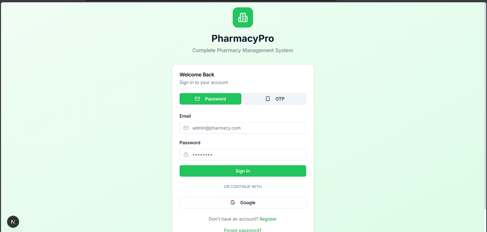
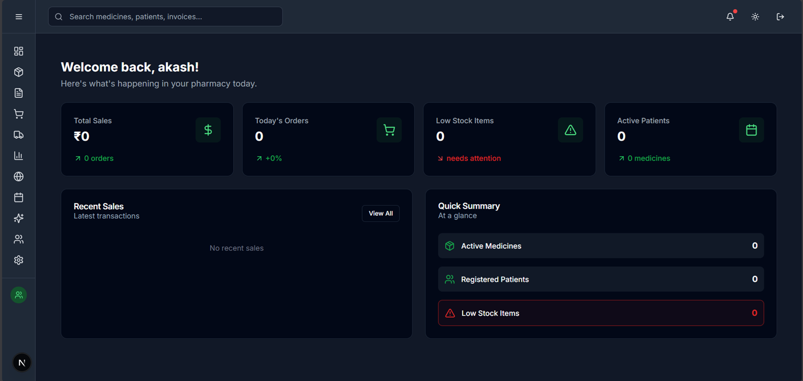
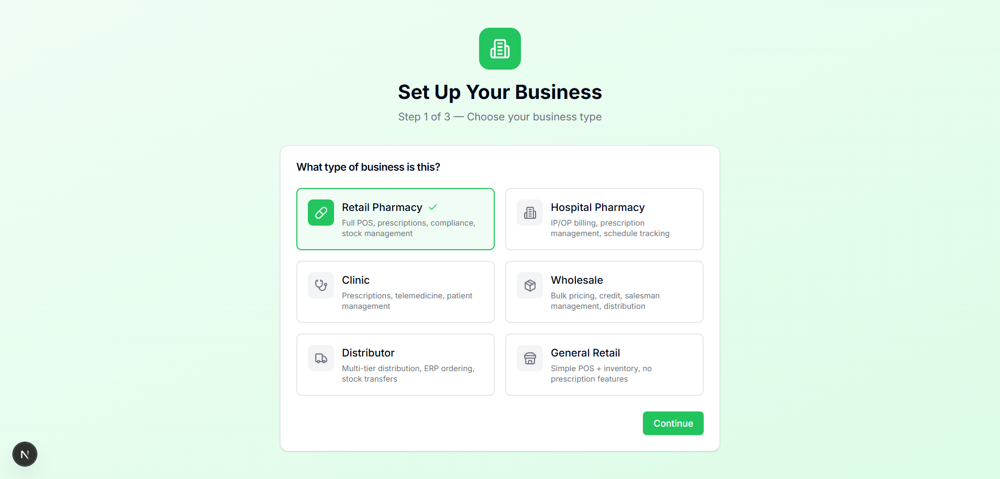

# 🏥 PharmacyPro - Pharmacy Management System

A Pharmacy Management System built with **Next.js 15** (App Router), TypeScript, Prisma,
and Tailwind/shadcn-ui.

> ⚠️ **Status note (2026-07-26):** The core MVP is functional and connected to PostgreSQL.
> Several advanced features remain placeholders — see [Current Status](#-current-status) below.

## Demo Credentials

| Role | Email | Password |
|------|-------|----------|
| Owner | admin@pharmacypro.com | admin123 |
| Manager | manager@pharmacypro.com | admin123 |
| Pharmacist | pharmacist@pharmacypro.com | admin123 |
| Cashier | cashier@pharmacypro.com | admin123 |

## ✨ Features

### MVP (Phase 1) — ✅ Implemented

- ✅ **Inventory Management** - Medicine CRUD, categories, suppliers, stock tracking
- ⚠️ **Prescription Management** - Doctors/patients real; upload UI is a stub (no OCR yet); processing wired to API
- ✅ **Sales & Billing** - POS with GST calculation, invoicing, returns
- ✅ **Purchase Management** - Purchase orders, GRN, supplier payments
- ✅ **User & Role Management** - Users list real; role assignment now works (RBAC not yet enforced in API)
- ✅ **Reporting (partial)** - Dashboard real; detailed Sales/Financial/Custom reports are stubbed
- ✅ **Security** - JWT auth, audit logs (now readable), input validation

### Phase 2 (Core Enhancements) — ⚠️ Partial

- ✅ **Batch & Expiry Tracking** - Schema + stock-alert page exist
- ❌ **Barcode/QR System** - Declared, not wired
- ⚠️ **Multi-Location Inventory** - Schema (StockTransfer) exists; no transfer UI
- ❌ **Auto-Reordering** - Not implemented
- ❌ **OCR for Prescriptions** - Not wired (Tesseract declared only)
- ✅ **GST-Compliant Invoicing** - Auto-calculate GST (5%, 12%, 18%)
- ⚠️ **Multi-Payment** - Cash/credit work; UPI/card have no gateway
- ✅ **Loyalty Program** - Schema + tiers seeded

### Phase 3 (Competitive Features) — ⚠️ Schema exists; UI placeholders

- ⚠️ **Online Pharmacy** - Schema + API routes exist; pages are placeholders
- ⚠️ **Delivery Management** - Schema exists; UI is placeholder
- ❌ **PWA** - No manifest/service worker
- ⚠️ **Advanced Reports** - Dashboard real; custom report builder is a stub
- ❌ **Integrations** - SMS/WhatsApp/GST/Drug APIs not wired
- ❌ **Security 2FA** - Column exists; no enrollment/verify flow

### Phase 4 (Advanced) — ⚠️ Partial schema / placeholder UI

- ⚠️ **Telemedicine Integration** - Placeholder UI; no backend yet
- ❌ **AI-Powered Features** - Declared, unused
- ⚠️ **Subscription Model** - Schema + seed exist; UI is placeholder
- ❌ **Multi-Language** - No i18n layer
- ❌ **Delivery Agent App** - Not present

## 📊 Current Status

| Area | Status |
|------|--------|
| Dashboard, Inventory, POS/Sales, Purchases | ✅ Working |
| Password auth, User management, Roles, Settings, Audit logs | ✅ Working |
| Prescriptions (doctors/patients/processing) | ✅ Working |
| Reports (detailed) | ⚠️ Dashboard real; detailed reports stubbed |
| Online Store, Subscriptions, Telemedicine, Analytics | ⚠️ Schema exists; UI placeholders |
| OCR, 2FA, Payments gateways, AI, PWA, i18n, Barcode/QR | ❌ Declared but unwired |

## 📸 Screenshots

| Login | Dashboard | Onboarding |
|-------|-----------|------------|
|  |  |  |

## 🛠️ Tech Stack

- **Framework**: Next.js 15 (App Router)
- **Language**: TypeScript
- **Styling**: Tailwind CSS + shadcn/ui
- **Database**: PostgreSQL + Prisma ORM
- **Auth**: NextAuth.js (JWT + OAuth)
- **State**: Zustand + TanStack Query

## 🚀 Quick Start

### Prerequisites

- Node.js 20+
- PostgreSQL 14+ running on `localhost:5432`

### Installation

```bash
# Clone the repository
git clone <repository-url>
cd pharmacy-management-system

# Install dependencies
npm install

# Setup environment variables
cp .env.example .env
# Ensure DATABASE_URL points to your PostgreSQL instance

# Generate Prisma client
npx prisma generate

# Run database migrations
npx prisma migrate dev

# Seed the database
npx prisma db seed

# Start development server
npm run dev
```

### Docker Setup

```bash
# Start all services
docker-compose up -d

# Run migrations
docker-compose exec app npx prisma migrate dev

# Seed database
docker-compose exec app npx prisma db seed
```

## 📁 Project Structure

```
pharmacy-management-system/
├── app/                    # Next.js App Router
│   ├── (auth)/            # Authentication pages
│   ├── (dashboard)/       # Dashboard
│   ├── inventory/         # Inventory management
│   ├── prescriptions/     # Prescription management
│   ├── pos/               # Point of Sale
│   ├── sales/             # Sales & billing
│   ├── purchases/         # Purchase orders
│   ├── reports/           # Analytics & reports
│   ├── online-store/      # E-commerce
│   ├── subscriptions/     # Subscription management
│   ├── analytics/          # AI-powered analytics
│   ├── telemedicine/      # Telemedicine integration
│   ├── users/             # User management
│   ├── admin/             # Admin settings
│   └── api/               # API routes
├── components/            # React components
│   └── ui/               # shadcn/ui components
├── lib/                   # Utilities & configurations
│   ├── db.ts             # Prisma client
│   ├── auth.ts           # NextAuth config
│   └── utils.ts          # Helper functions
├── prisma/               # Database schema
├── types/                # TypeScript types
├── public/               # Static assets
└── docker/               # Docker configurations
```

## 📄 License

MIT License - see LICENSE file for details.

## 🤝 Support

For support, email support@pharmacypro.com or join our Slack channel.
